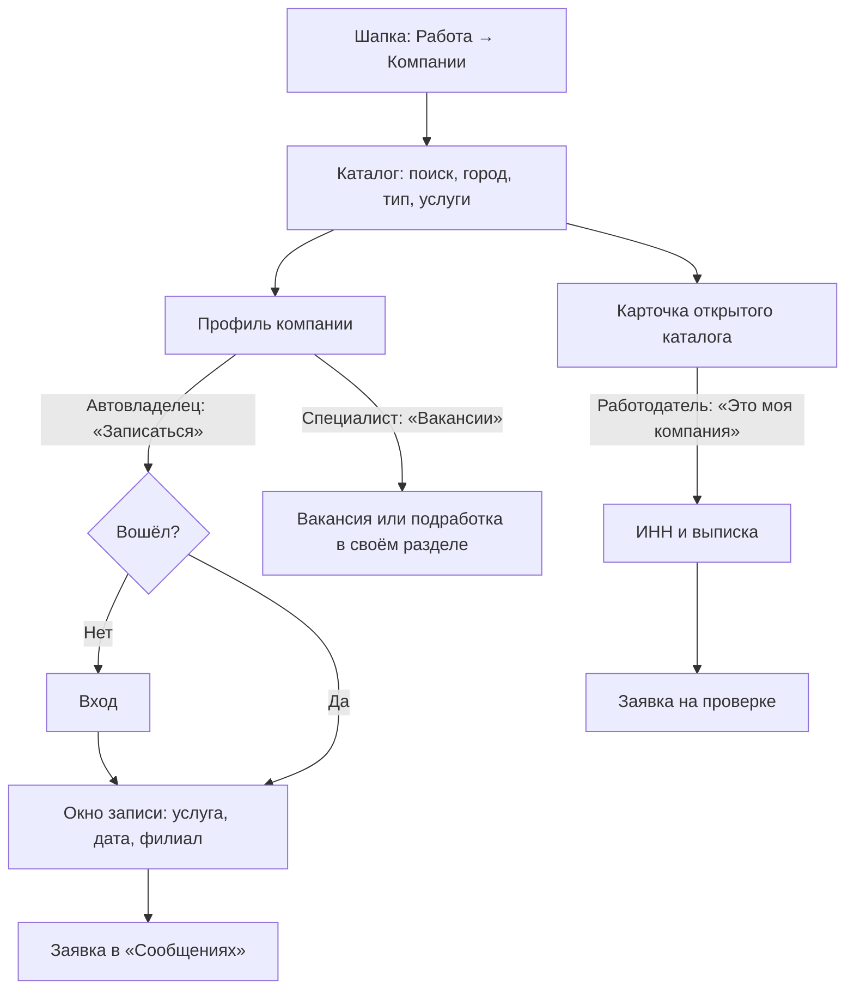

# Компании: каталог, профиль и карточка открытого каталога

Прототип: [`index.html`](index.html). Каталог `#/`, профиль `#/v/company-001`, карточка открытого каталога `#/d/directory-001`. Переключатель ролей в правом нижнем углу.

Основа: `/companies` (`catalogPage` в `pages.mjs`), `/companies/:id` (`publicProfilePage`, `companyProfile`, `profileContact` в `workspace-pages.mjs`), `/companies/directory/:id` (`companiesDirectoryPage`). Функционал сверен с coyc.pro, раздел «Компании» в [`refs/coyc.md`](../../refs/coyc.md).

## Что изменилось в структуре

- **Один каталог для компаний на СОУС и открытого каталога.** Карточки, которые компания ещё не подтвердила, стоят в конце списка: без рейтинга и кнопки «Написать», с пометкой «Компания не подтвердила карточку».
- **Профиль одной страницей вместо вкладок.** Обзор, услуги, цены, филиалы, вакансии, портфолио и отзывы идут разделами подряд, как в профиле специалиста. Вкладки «Новости» и «Команда» пока не делали: см. открытые вопросы.
- **Каталог закрыт для работодателей**, как на coyc.pro. Работодатель видит ссылку на профиль своей компании и в каталог специалистов.
- **«Профиль компании» на вакансиях и подработках** теперь ведёт на нужную компанию, а не всегда на Shine&Go (`companyHref()` в `sous.js`).

## Что убрали

| Было на стенде | Почему лишнее | Стало |
|---|---|---|
| Счётчики «86 компаний, 32 подтверждённых, 4 города» в шапке | Повторяют счётчик над списком | Один счётчик над списком, «Документы проверены» стал фильтром |
| Рейтинг в поле «зарплата», вакансии в поле «график» | Данные не на своём месте | Рейтинг, режим работы и вакансии отдельными фактами |
| Плашки «Документы проверены», «Сертифицирован» | Цветной шум | Зелёный значок проверки у названия |
| Вкладки профиля и дубли «Популярные услуги» в обзоре | Одни и те же услуги в двух местах | Один раздел «Услуги и цены» |
| Кнопки «Поделиться», «Ещё», «в сети», «обычно отвечает в течение часа» | Не помогают выбрать компанию | Убраны |
| Плашка-предупреждение на карточке открытого каталога | Цветной шум | Тихая строка «Компания ещё не подтвердила карточку» |

## Что добавили

- **Цена «от» в карточке каталога** с названием самой дешёвой услуги: автовладелец сразу видит порядок цен.
- **Запись на услугу:** кнопка «Записаться» у каждой услуги (автовладельцу и гостю). Окно с услугой, датой (`datePick`) и филиалом, заявка уходит в «Сообщения».
- **Вакансии и подработки компании** в профиле со ссылками в разделы «Вакансии» и «Подработки». Специалист в каталоге видит кнопку «Вакансии» с числом, она ведёт сразу к этому разделу профиля.
- **Адрес и телефон после входа**, как на coyc.pro: гость видит город филиала и «Показать адрес», телефон под маской.
- **Подтверждение компании** на карточке открытого каталога: ИНН, роль, выписка ЕГРЮЛ или ЕГРИП, «Отправить на проверку».

## Роли на странице

| Роль | Каталог | Профиль компании | Карточка открытого каталога |
|---|---|---|---|
| Гость | Смотрит всё, «Написать» просит войти | Адрес и телефон после входа, вход на «Написать» и «Записаться» | «Это моя компания» (вход как компания), телефон |
| Автовладелец | «Написать» в карточке | «Написать компании», «Записаться» у услуг, подписка, телефон | Телефон |
| Специалист | «Вакансии» с числом в карточке | «Вакансии» главной кнопкой, «Написать компании» | Телефон |
| Работодатель | Каталог закрыт, ссылка на свой профиль | Свой: «Редактировать профиль». Чужой: «Написать компании» | «Это моя компания» |
| Поставщик | Подсказка про заявки на закупку | «Написать компании» | Телефон |
| Партнёр | Каталог | «Написать компании» | Телефон |

## User flow

## Модальные сценарии

- **Сообщение компании:** тема (запись, вопрос об услуге, работа в компании, другое) и текст.
- **Запись на услугу:** услуга с ценой, дата, филиал, сообщение.
- **Подтвердить компанию:** ИНН (10 или 12 цифр), роль, выписка.
- **Жалоба на компанию.**

## Открытые вопросы к заказчику

1. Каталог закрыт для работодателей на coyc.pro: это сознательное решение? Работодателю может быть полезно смотреть компании-партнёров или конкурентов по зарплатам.
2. Нужны ли в профиле разделы «Новости» и «Команда»? Новости, скорее всего, дублируют ленту, а команда пересекается с профилями специалистов.
3. Запись на услугу: это заявка в сообщения или нужна настоящая онлайн-запись со слотами времени?
4. Откуда берутся карточки открытого каталога и можно ли по ним писать компании до подтверждения?
5. Режим «По филиалам» с coyc.pro: показывать в списке каждый филиал отдельно или компанию целиком, как сейчас?
