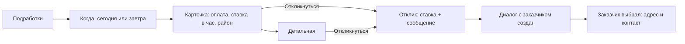
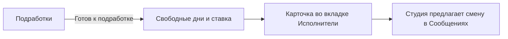
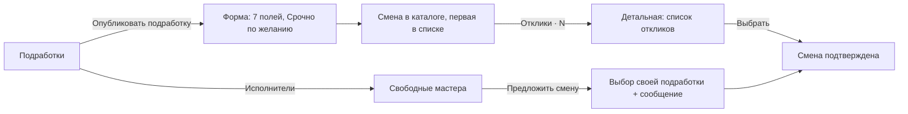

# Подработки и подмены: UX и user flow

Прототип: [`index.html`](index.html). Каталог `#/`, исполнители `#/workers`, детальная `#/v/gig-016`. Переключатель ролей в правом нижнем углу.

Основа: экраны `/gigs` и `/gigs/:id` со стенда (`catalogPage` в `pages.mjs`, `taskDetail` в `workspace-pages.mjs`, окна `gig.create` и `gig.apply`). Функционал сверен с coyc.pro (раздел «Подработки» в [`refs/coyc.md`](../../refs/coyc.md)). Каркас и компоненты те же, что у вакансий.

## Что убрали

| Было на стенде | Почему лишнее | Стало |
|---|---|---|
| Табы «Все подработки 13 / Срочно 13 / Исполнители», где «Исполнители» уводят на `/specialists` | Счётчики одинаковые, третий таб уводит со страницы | Две вкладки: «Подработки» и «Исполнители». «Срочно» стало фильтром и тихой меткой в карточке |
| Строка «13 открытых · 6 062 ₽ средняя ставка · 4 города» | Повторяет счётчик над списком, средняя ставка ничего не решает | Один счётчик над списком. Ставка в час есть в каждой карточке |
| Плашки-теги «Срочно», «Мойка + салон» | Цветной шум | Метка «Срочно» с молнией, тип работ ушёл в фильтр |
| «Отклики: 2 отклика» в поле «опыт» | Данные не на своём месте | Отклики отдельной строкой в карточке, «Пока никто», если нет |
| Детальная: картинка-герой, «Как СОУС защищает», «Не переводите деньги вне платформы», дубли оплаты в шапке, правой колонке и «Условиях смены» | Одна цифра трижды, шаблонные блоки | Оплата в фактах и в карточке действия. Три блока: «Что нужно сделать», «Требования и что взять», «Где и когда» |
| Поле «Можете выйти к» в отклике | Время смены уже задано заказчиком | В отклике только ставка и сообщение |
| «Минимальная ставка» и «Длительность, часов» в создании | Второй ввод того же: длительность считается из времени | Дата, время, оплата. Длительность и ставка в час считаются сами |

## Что добавили

- **Когда смена — главный фильтр.** «Сегодня, Завтра, На выходных, Позже» стоят первыми, сортировка по умолчанию «Сначала ближайшие». Подработку ищут по дню, а не по должности.
- **Ставка в час рядом с оплатой:** «4 500 ₽, за смену · 750 ₽/ч». Смены разной длины можно сравнить.
- **Вкладка «Исполнители»:** мастера со статусом «готов к подработке» (есть на coyc.pro), когда свободны, желаемая ставка, рейтинг и число смен. Работодатель предлагает смену сам, не дожидаясь откликов.
- **«Готов к подработке» для специалиста:** главное действие в шапке. Отмечает свободные дни и ставку, после этого попадает в список исполнителей.
- **Отклики прямо на детальной у владельца:** ставка, рейтинг, сообщение, кнопки «Написать» и «Выбрать». Выбор подтверждает смену: исполнитель получает адрес и контакт, остальные узнают, что смена занята. Для смены «на завтра» поход в кабинет лишний.
- **Срочная подмена:** галочка в форме «смену увидят все мастера в радиусе 30 км» (строка с coyc.pro).
- **Адрес раскрывается после подтверждения**, в карточке только район.
- **Мобилка:** первая смена на первом экране, фильтры в шторке, на детальной закреплена панель «оплата + Откликнуться» (у владельца «Отклики · N»). Действие в шапке на телефоне остаётся иконкой.

## Роли на странице

| Роль | Действие в шапке | Карточка подработки | Карточка исполнителя | Детальная |
|---|---|---|---|---|
| Гость | Опубликовать подработку (вторичная), на вкладке исполнителей «Стать исполнителем» | Откликнуться → вход | Предложить смену → вход | Откликнуться → вход |
| Специалист | Готов к подработке (основная) | Откликнуться / «Отклик отправлен» | Своя карточка «Вас видят студии» | Откликнуться, после отклика «Перейти к диалогу» |
| Работодатель | Опубликовать подработку (основная) | Свои первыми: «Отклики · N» | Предложить смену | Свои: отклики, выбор исполнителя, изменить, закрыть |
| Автовладелец, поставщик, партнёр | нет | Просмотр и подсказка, куда идти | Просмотр | Просмотр и подсказка |

## User flow

### Специалист берёт смену

### Специалист ждёт предложений

### Работодатель закрывает смену

## Модальные сценарии

`gig.create` (и редактирование) · `gig.apply` · `gig.ready` (готов к подработке) · `gig.offer` (предложить смену исполнителю) · `gig.choose` (подтвердить исполнителя) · `gig.close` · `report.create` · `auth.required` · фильтры (шторка на мобилке).

## Новое в общих компонентах

- `.urgent`: тихая метка «Срочно» с молнией. Пригодится в заявках автовладельцев.
- `.resp` и `.resp-row`: список откликов у владельца. Тот же блок нужен в заявках автовладельцев и заявках на закупку.
- Иконки `zap`, `calendar`, `star`.

## Глоссарий страницы

| Термин | Значение | Не используем |
|---|---|---|
| Подработка | Разовая смена или срочная подмена | «Задача», «гиг», «срочные подмены» как отдельный раздел |
| Смена | Конкретный день и время подработки | «Слот» |
| Срочно | Смена в ближайшие сутки, видна мастерам в радиусе 30 км | «Горящая» |
| Исполнитель | Специалист со статусом «готов к подработке» | «Специалисты» в этом контексте |
| Заказчик | Компания, которая опубликовала подработку | «Работодатель» на детальной (это не найм) |
| Отклик | Специалист отвечает на подработку | «Заявка» |
| Предложить смену | Работодатель зовёт исполнителя на свою подработку | «Пригласить» (это для вакансий) |

## Открытые вопросы к заказчику

1. Оплата идёт мимо платформы (наличными или на карту от студии) или через СОУС с удержанием до закрытия смены? От этого зависит текст «Оплата после закрытия смены» со стенда, сейчас его нет.
2. Нужен ли отзыв друг о друге после смены? Рейтинг и число смен в карточке исполнителя без этого не набираются.
3. Можно ли откликнуться без резюме, только с профилем? В прототипе прикрепляется профиль и портфолио.
4. Радиус 30 км для срочных фиксированный или настраивается?
5. Что видит исполнитель, если смену закрыли после его отклика: уведомление и автоматический отказ в диалоге?
