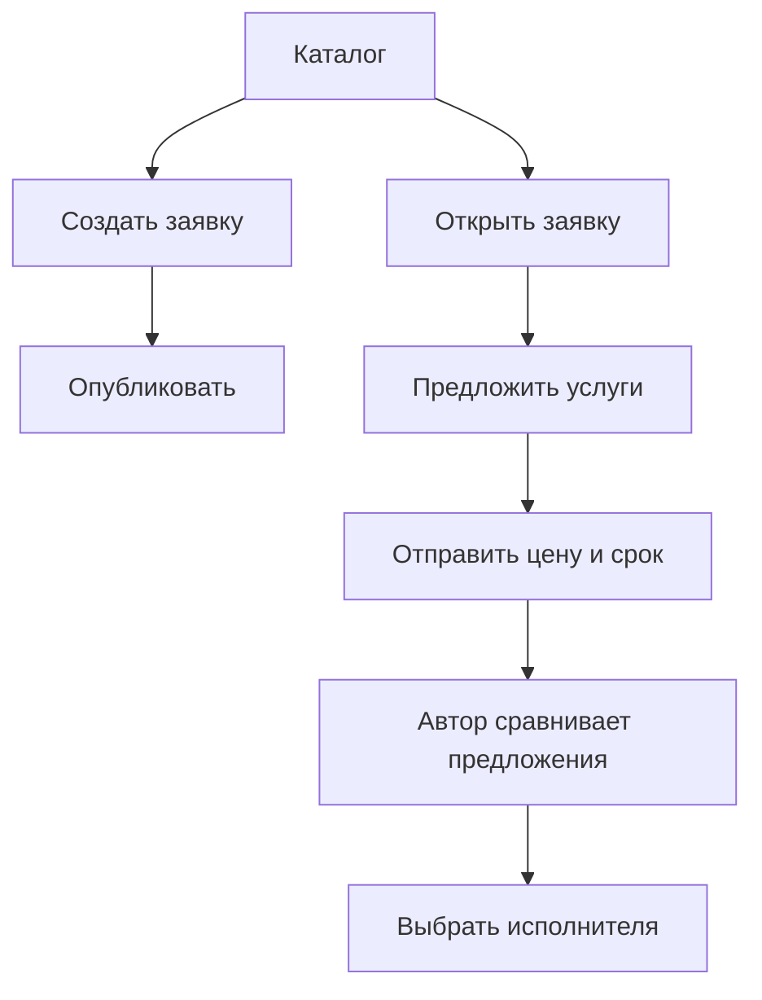

# Заявки автовладельцев

[Каталог](https://shmemka.github.io/sous/orders/#/) и [заявка на обработку Toyota RAV4](https://shmemka.github.io/sous/orders/#/v/order-001). У заявки есть демопредложение, чтобы в роли автовладельца сразу попробовать выбор исполнителя.

## Решения

На стенде счётчики всех, срочных и дорогих заявок расходились с примерами. В каталоге теперь один счётчик результатов, поиск по автомобилю или задаче и два фильтра. В карточке видны автомобиль, район, срок и бюджет. Форму можно открыть из списка. Вкладка «Мои заявки» доступна автовладельцу.

На детальной странице остались описание, вложения и условия конкретной заявки. Шаблонные советы по выполнению работ убраны. На телефоне бюджет и действие закреплены внизу. Адрес виден автору и откликнувшемуся исполнителю. Остальные видят город и район.

## Роли и окна

| Роль | Действие |
|---|---|
| Гость | Смотрит каталог и карточку. Заполняет заявку или предложение, входит при отправке. |
| Автовладелец | Публикует заявку с автомобилем, местом, датой, описанием и необязательным бюджетом. Добавляет до трёх фото или одно видео. В своей заявке сравнивает предложения и выбирает исполнителя. |
| Специалист, работодатель | Предлагает цену, срок и состав работ. Одно предложение от каждой демонстрационной роли на заявку. После выбора исполнителя новые предложения закрыты. |
| Поставщик, партнёр | Смотрит заявки. |

Формы публикации, предложения и входа открываются в окнах. Заявки, файлы и выбор исполнителя хранятся в IndexedDB текущего браузера. Переключатель ролей позволяет пройти обе стороны сценария на одном устройстве.

## Источники и открытый вопрос

Примеры задач взяты из `refs/stand/data.mjs`, сценарии из `order.create` и `order.apply`, поля формы и правило показа адреса из `refs/coyc.md`.

Для прототипа отклик разрешён и специалистам, и компаниям в роли работодателя. Нужно ли для отклика компании требовать подтверждённый профиль?
