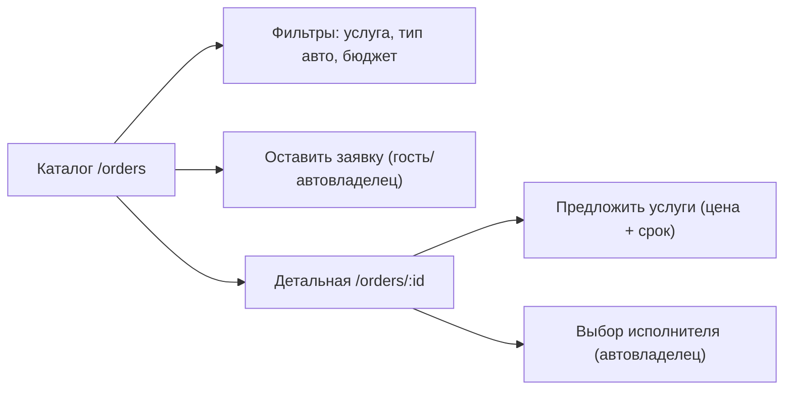

# Заявки автовладельцев (`/orders` и `/orders/:id`)

[Каталог заявок](https://shmemka.github.io/sous/orders/#/) и [детальная заявки](https://shmemka.github.io/sous/orders/#/v/order-001).

## Что изменилось
- Убраны дубли фильтров по городу (город задаётся один раз в строке поиска) и лишние обводки карточек.
- Добавлен фильтр по типу авто (Седан, Хэтчбек, Кроссовер, Внедорожник, Минивэн, Универсал) и услуге.
- Вместо длинного тире в заголовках марка и кузов автомобиля вынесены в отдельную строку под заголовком.
- Для автовладельца добавлена вкладка «Мои заявки», публикация заявки (включая заполнение формы гостем до входа) и выбор исполнителя среди предложений.
- Точный адрес скрыт до момента отклика исполнителя.

## Роли и действия
| Роль | Главное действие |
|---|---|
| Гость | Смотрит заявки, заполняет форму заявки до входа, при отклике входит как исполнитель |
| Автовладелец | Оставляет заявку, смотрит вкладку «Мои заявки», выбирает исполнителя |
| Специалист / Работодатель | Предлагает стоимость и срок, получает точный адрес после отклика |
| Поставщик / Партнёр | Видит тихую подсказку о профильном разделе |

## User flow

## Модальные окна
- `createModal` — публикация заявки (услуга, тип авто, автомобиль, город, район, желаемая дата через `datePick`, бюджет, описание, фото/видео).
- `respondModal` — предложение цены, срока и состава работ.
- `filtersSheet` — мобильная шторка фильтров.
- `reportModal` — жалоба на заявку.
