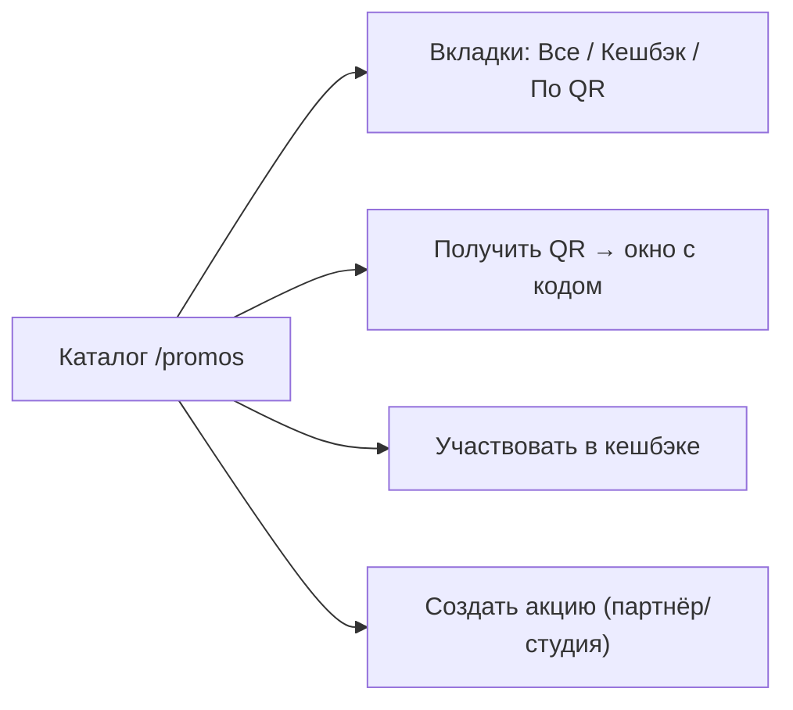

# Кешбэк и акции (`/promos` и `/promos/:id`)

[Каталог акций](https://shmemka.github.io/sous/promos/#/) и [детальная акции](https://shmemka.github.io/sous/promos/#/v/promo-001).

## Что изменилось
- Убраны три строки промо-статистики в шапке, оставлен один счётчик над списком.
- Город выбирается в одном месте (включая вариант «Вся Россия»), убраны цветные теги-плашки на карточках.
- Добавлены вкладки по механике («Все акции», «Кешбэк», «По QR») и фильтры по услуге и проверенным партнёрам.
- На карточке и в окне условий сразу доступна активация: генерация QR-кода для скидки или подключение к программе растущего кешбэка.

## Роли и действия
| Роль | Главное действие |
|---|---|
| Гость | Смотрит акции, при активации или создании входит в нужную роль |
| Автовладелец / Специалист | Получает QR-код или участвует в кешбэке, переходит в «Мои промокоды» |
| Партнёр / Работодатель | Создаёт новую акцию (скидка по QR или растущий кешбэк) |
| Поставщик | Видит тихую подсказку со ссылкой на каталог поставщиков |

## User flow

## Модальные окна
- `detailsModal` — условия акции, остаток активаций и кнопка действия.
- `qrModal` — QR-код и буквенно-цифровой код для показа сотруднику.
- `createModal` — создание новой акции с выбором даты через `datePick`.
- `filtersSheet` — мобильная шторка фильтров.
