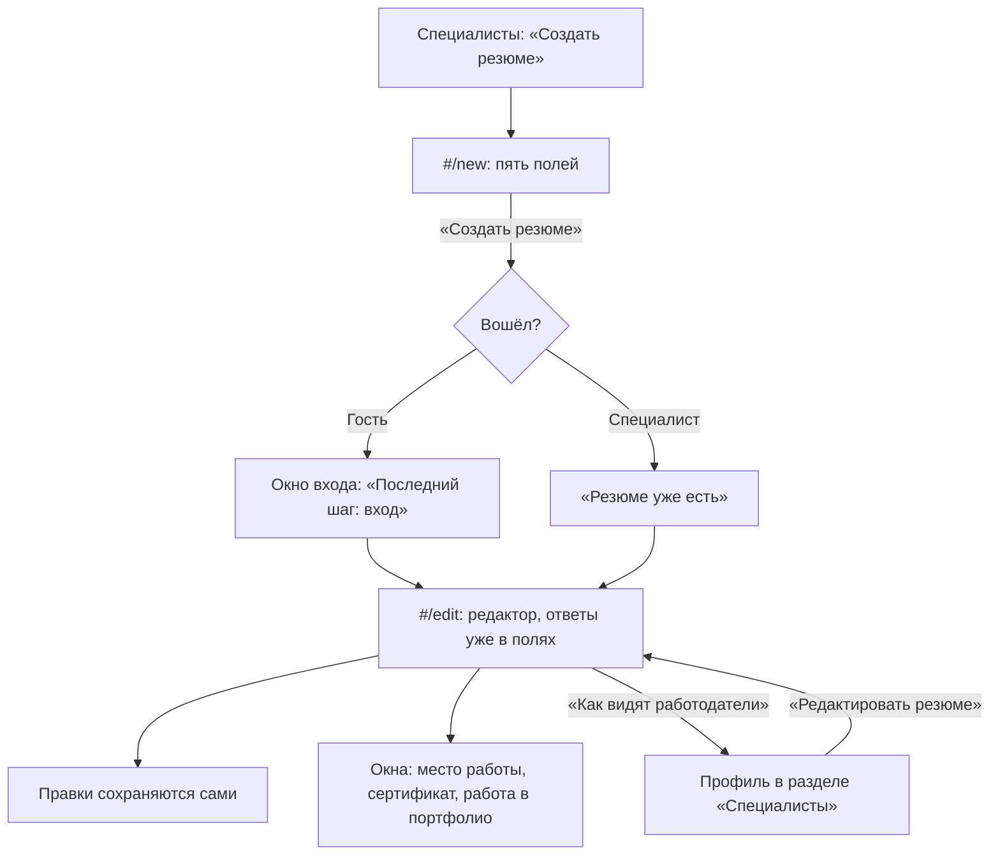

# Резюме: создание и редактор

Прототип: [`index.html`](index.html). Быстрый старт `#/new`, редактор `#/edit`. Переключатель ролей в правом нижнем углу.

Основа: экраны `/resume/new` (`resumeNewPage`) и `/resume/:id/edit` (`resumeEditPage`, `resumeStepContent` в `pages.mjs`), окно `work.create` в `modals.mjs`. Поля сверены с разделом «Специалисты и резюме» в [`refs/coyc.md`](../../refs/coyc.md).

`/resume/:id` и `/resumes` на стенде только переадресуют в «Специалисты». В прототипе они тоже ведут туда: публичное резюме и есть профиль специалиста, отдельной страницы у него нет.

## Что изменилось в структуре

- **Две формы стали одной цепочкой без повторов.** На стенде имя, специализацию, город и опыт вводили в форме создания, а потом ещё раз на первом шаге конструктора. Теперь быстрый старт спрашивает их один раз, и редактор открывается уже заполненным.
- **Мастер из 5 шагов стал одной страницей с разделами.** «Назад», «Далее», «Шаг 2 из 5» и «Выйти» убраны: резюме правят точечно (поменять зарплату, добавить работу), а мастер заставлял проходить шаги по порядку. Справа карточка с процентом заполненности и списком разделов: клик прокручивает к разделу, у незаполненных подсказка, что добавить.
- **Разделы редактора повторяют профиль**, который видят работодатели: основное, что ищу, о себе и навыки, опыт работы, сертификаты, портфолио, дополнительно, контакты. На стенде в конструкторе не было опыта работы и сертификатов, хотя в профиле они есть.
- **Резюме публикуется сразу после быстрого старта.** На стенде для публикации нужно было 70% заполненности. Здесь обязательны только имя, должность, специализация и город, а процент работает как подсказка (см. открытые вопросы).

## Что убрали

| Было на стенде | Почему лишнее | Стало |
|---|---|---|
| Повторный ввод имени, специализации, города и опыта в конструкторе | Второй ввод одного и того же | Редактор заполнен ответами быстрого старта |
| Шаги «Кто я», «Где работаю», «Условия», «Портфолио», «Контакты» с кнопками «Назад» и «Далее» | Нельзя сразу попасть в нужное место | Одна страница, навигация по разделам справа |
| Список «Статус: Ищу работу, Готов к подработке, Работаю» | Нельзя выбрать и работу, и подработки, хотя в каталоге такие статусы есть | Две карточки «Постоянная работа» и «Подработки и подмены», можно обе или ни одной |
| «Специализация: Детейлер · Полировка · PPF» одной строкой | Фильтр каталога не может по ней искать | Специализация из списка (для фильтров) и должность свободным текстом (для заголовка) |
| Гражданство и медкнижка в шаге «Где работаю» | Не относится к месту работы | Раздел «Дополнительно» |
| Навыки фиксированными галочками | Пять вариантов на все специальности | Свои навыки плюс подсказки «Часто добавляют» по специализации |
| «Сохранено только что» под кнопками шагов | Не видно, когда сохранилось | «Изменения сохранены в 14:53» в карточке справа |
| Цветная плашка «Резюме заполнено на 82% и готово к публикации» | Дублирует прогресс | Процент и строка «Опубликовано, студии видят резюме» |

## Что добавили

- **Быстрый старт без регистрации:** пять полей и выбор «что ищете». Вход по телефону запрашивается только на кнопке «Создать резюме», после входа сразу открывается редактор.
- **Зарплата и ставка появляются по выбору.** Отмечена «Постоянная работа»: зарплата от и график. «Подработки»: когда свободны и ставка за смену. Ничего не отмечено: подсказка, что резюме останется портфолио со статусом «Не ищет работу».
- **Опыт работы, сертификаты, портфолио** добавляются в окнах. Каждую запись можно изменить или удалить. Места работы сортируются от последнего.
- **Сертификаты Учебного центра СОУС** попадают в резюме сами, с зелёным значком проверки, удалить или изменить их нельзя. Сертификаты других школ добавляет сам специалист, со сканом.
- **Видимость:** переключатель «Показывать в поиске» и ссылка «Как видят работодатели» на свой профиль.
- **Контакты:** телефон берётся из аккаунта. Пояснение, что контакты видят только работодатели с подпиской и каждый просмотр попадает в журнал.

## Роли на странице

| Роль | Быстрый старт `#/new` | Редактор `#/edit` |
|---|---|---|
| Гость | Форма из пяти полей, вход на кнопке «Создать резюме» | «Войдите, чтобы открыть резюме», кнопки «Войти» и «Создать резюме» |
| Специалист | «Резюме уже есть» с процентом заполненности и ссылкой в редактор | Редактор своего резюме |
| Работодатель | «Резюме создают специалисты», ссылки в каталог специалистов и на вакансии | Ссылка в каталог специалистов |
| Автовладелец, поставщик, партнёр | Подсказка, что резюме привязано к аккаунту специалиста | Ссылка в каталог специалистов |

## User flow

## Модальные сценарии

- **Место работы:** должность, компания и город, год начала, окончание или «По настоящее время», что делали.
- **Сертификат:** название курса, кто выдал, год, номер, скан или фото.
- **Работа в портфолио:** название, тип работ, автомобиль, что сделано, фото и видео (до 12 работ в портфолио).

## Новое в общих компонентах

- Иконки Tabler: `circle`, `done` (circle-check), `trash`, `upload`, `camera`.
- В `pages.js` готовы `/resume/new` и `/resume/:id/edit`. `/resume/:id` и `/resumes` отмечены как переадресация в «Специалисты».
- Кнопка гостя «Создать резюме» в каталоге специалистов ведёт сюда, без окна входа: вход спрашиваем в конце формы.

## Открытые вопросы к заказчику

1. Можно ли публиковать резюме сразу после быстрого старта? На стенде порог 70% заполненности. Мы предлагаем публиковать сразу, а процент показывать как подсказку: иначе новичок не попадёт в каталог, пока не соберёт портфолио.
2. Одно резюме на специалиста или несколько, под разные специализации? Сейчас одно.
3. Нужна ли проверка внешних сертификатов модерацией, как у документов? Сейчас скан просто виден в профиле.
4. Сколько работ в портфолио и какой размер файлов: на стенде «до 12 файлов» на всё портфолио, мы считаем 12 работ по 10 файлов.
5. Нужен ли отдельный переключатель «Показывать телефон только после приглашения», как на стенде, если контакты и так видны только работодателям с подпиской?
