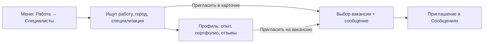
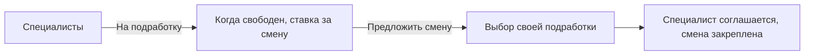
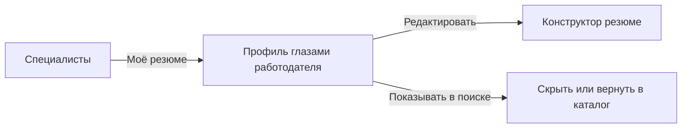

# Специалисты и профиль-резюме: UX и user flow

Прототип: [`index.html`](index.html). Каталог `#/` (вкладки `#/looking`, `#/gigs`), профиль `#/v/worker-001`. Переключатель ролей в правом нижнем углу.

Основа: экраны `/specialists` (`catalogPage` в `pages.mjs`) и `/specialists/:id` (`publicProfilePage`, `workerProfile`, `profileContact` в `workspace-pages.mjs`), окно `specialist.invite`. Функционал сверен с coyc.pro (раздел «Специалисты и резюме» в [`refs/coyc.md`](../../refs/coyc.md)).

## Что изменилось в структуре

- **Резюме переехали из вакансий в «Специалисты».** Раньше резюме были вкладкой на странице вакансий. Теперь у каждой аудитории своя страница: специалист ищет работу в «Вакансиях», работодатель ищет людей в «Специалистах». Старый адрес `vacancies/#/resumes` переадресует сюда.
- **В меню «Работа» отдельный пункт «Специалисты»** между «Вакансиями» и «Подработками».
- **Вкладки по статусу, как на coyc.pro:** «Все», «Ищут работу», «На подработку». Специалисты, которые не ищут работу, видны во «Все» в конце списка: их профиль работает как портфолио.

## Что убрали

| Было на стенде | Почему лишнее | Стало |
|---|---|---|
| «14 специалистов · 9 сертифицированных · 4 города» | Повторяет счётчик над списком | Один счётчик, сертификаты стали фильтром |
| Плашки «Документы проверены», «Сертифицирован», «Доступен для подработок» | Цветной шум | Щит с подсказкой у должности, статус тихим текстом |
| Рейтинг в поле «опыт», опыт в поле «график» | Данные не на своём месте | Опыт, рейтинг и отзывы отдельными фактами |
| Профиль: обложка-картинка, «в сети», подписчики, «Подписаться», «Поделиться», «Ещё» | Соцсеть вместо резюме, ничего не решает при найме | Убраны |
| Вкладки профиля «Резюме / Портфолио / Сертификаты / Отзывы» | Работодатель листает четыре вкладки, чтобы оценить человека | Одна страница: о себе, опыт, портфолио, сертификаты, отзывы, дополнительно |
| Рейтинг дважды (в шапке и в «Проверках»), блок «Проверки специалиста» отдельно | Дубли | Рейтинг в фактах и над отзывами, проверка у имени и у сертификата |
| «Показать телефон» любому | Противоречит coyc.pro: контакты по подписке | Телефон скрыт, «Показать» объясняет подписку и предлагает связаться приглашением |

## Что добавили

- **Действие зависит от статуса специалиста.** Ищет работу: «Пригласить» на вакансию. Только подработки: «Предложить смену». Не ищет: «Написать». Работодатель не тратит приглашение на того, кто работу не ищет.
- **Когда свободен для подработки** прямо в статусе: «Готов к подработке на выходных».
- **Деньги по статусу:** ожидания в месяц, ставка за смену или число работ в портфолио у тех, кто не ищет.
- **Своё резюме:** специалист видит его первым в каталоге с подписью «так его видят работодатели», в профиле есть «Редактировать резюме» и переключатель «Показывать в поиске».
- **Сертификаты Учебного центра** с номером, отметкой «Подлинность подтверждена» и кнопкой «Проверить» (ведёт на `/training/certificate/:id`).
- **Ссылки на профиль работают с других страниц:** из вкладки «Исполнители» на подработках открывается профиль нужного человека (`pageHref` теперь подставляет id).

## Роли на странице

| Роль | Действие в шапке | Карточка | Профиль |
|---|---|---|---|
| Гость | Создать резюме | Пригласить / Предложить смену → вход | То же, вход возвращает к профилю и открывает окно |
| Работодатель | Мои вакансии | Пригласить / Предложить смену / Написать | Главное действие по статусу, второстепенные рядом, контакты по подписке |
| Специалист | Моё резюме | Своя карточка первой, «Редактировать» | Своё: редактор и видимость. Чужое: просмотр и подсказка |
| Автовладелец, поставщик, партнёр | нет | Просмотр и подсказка, куда идти | Просмотр и подсказка |

## User flow

### Работодатель нанимает в штат

### Работодатель ищет человека на смену

### Специалист управляет резюме

## Модальные сценарии

`specialist.invite` (на вакансию) · `gig.offer` (предложить смену) · `contacts.subscription` (прямые контакты по подписке) · `report.create` · `auth.required` · фильтры (шторка на мобилке).

## Новое в общих компонентах

- `.d-person` (шапка профиля человека), `.status-line`, `.skills`, `.timeline`, `.gallery`, `.cert`, `.rating-sum`, `.review`, `.lines`, `.contact-mask`. Подойдут для профилей компаний и поставщиков.
- Иконки `award`, `image`, `phone`.
- На телефоне, если в шапке есть вкладки, вкладки прокручиваются, а у кнопки действия остаётся иконка.

## Глоссарий страницы

| Термин | Значение | Не используем |
|---|---|---|
| Специалист | Мастер с профилем на СОУС, в любом статусе | «Соискатель», «кандидат» в каталоге |
| Резюме | Профиль специалиста, который ищет работу | «Каталог резюме» |
| Ищет работу | Статус: открыт к постоянной работе | «Ищу работу» в чужом профиле |
| Готов к подработке | Статус: берёт разовые смены, с указанием когда | «Доступен для подработок» |
| Пригласить | Позвать на свою вакансию | «Предложить вакансию» |
| Предложить смену | Позвать на свою подработку | «Пригласить на подработку» |

## Открытые вопросы к заказчику

1. Подписка работодателя: что именно открывает (телефон, email, Telegram, все резюме) и сколько стоит? В прототипе контакты скрыты, кнопка ведёт к тарифам.
2. Видят ли профиль специалиста автовладельцы и можно ли им написать напрямую, или только через заявку?
3. Отзывы: оставляет только работодатель после смены или работы, или любой пользователь? Нужна ли модерация?
4. Портфолио: фото загружает сам специалист или студия может подтвердить работу?
5. Специалистов, которые не ищут работу, показывать в каталоге по умолчанию или только по прямой ссылке?
