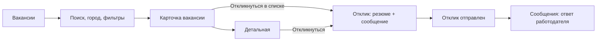
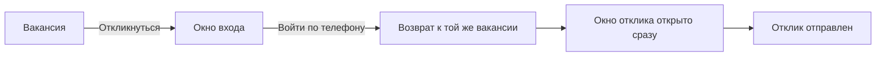
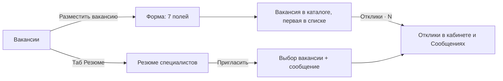

# Вакансии и резюме: UX и user flow

Прототип: [`index.html`](index.html) (десктоп и мобилка, тёмная и светлая темы, переключатель ролей в правом нижнем углу).
Основа: экран `/vacancies` и `/vacancies/:id` со стенда, функционал сверен с coyc.pro. Правила полировки взяты из скила [unslop](https://github.com/heydamir/unslop) в щадящем режиме: бренд, палитра и шрифты стенда сохранены.

## Что убрали

| Было на стенде | Почему лишнее | Стало |
|---|---|---|
| Подпись «РАБОТА · ВАКАНСИИ» капсом | Дублирует заголовок и табы | Убрана |
| Строка «21 активная вакансия · 14 специалистов · 4 города» | Противоречит «Найдено 4», повторяет счётчики табов | Один счётчик над списком: «8 вакансий» |
| Город в поиске и ещё раз в фильтрах | Одно действие в двух местах | Город только в строке поиска |
| Фильтр «С предложением цены» | Для вакансий не имеет смысла | Убран |
| Зелёные плашки «Проверено» и теги-пилюли в каждой карточке | Шум, всё выделено и поэтому ничего не выделено | Тихая отметка «Проверена» со щитом у названия компании |
| Подпись «предложение» под зарплатой | Непонятно, что значит | «в месяц на руки», как на coyc.pro |
| Кнопка «Подробнее» | Дублирует клик по карточке | Кликабельна вся карточка |
| Детальная: «Ваши задачи», «Что для нас важно» (общие слова), «Бенефиты», карта-заглушка, «Как СОУС защищает» | Шесть блоков, половина — шаблонный текст | Четыре блока: «О работе», «Что делать», «Условия», «Где работать» |
| Шапка: 12 ссылок в две строки | Нет групп, тяжело найти | 5 групп по задачам с выпадающими меню |

## Что добавили

- **Действие зависит от роли.** Компания видит «Разместить вакансию», специалист — «Откликнуться» и «Моё резюме», гость — всё то же, но вход запрашивается в момент действия.
- **Свои вакансии работодателя** стоят первыми, с меткой «Ваша вакансия · 3 новых отклика» и кнопкой «Отклики» вместо «Откликнуться».
- **Подсказка для нецелевых ролей.** Автовладелец, поставщик и партнёр видят одну строку: куда им на самом деле (заявки, закупки, акции).
- **Активные фильтры** показаны чипами над списком, каждый снимается одним кликом. Есть пустое состояние с кнопкой «Сбросить фильтры».
- **Ссылка на подработки** прямо в подзаголовке: «Разовые смены — в разделе Подработки». Человек, который ищет смену, не теряется в вакансиях.
- **Мобилка:** первая вакансия на первом экране, фильтры и сортировка в нижней шторке, на детальной закреплена панель «зарплата + Откликнуться».

## Шапка: 5 групп вместо 12 ссылок

| Группа | Разделы |
|---|---|
| Работа | Вакансии и резюме · Подработки · Компании |
| Автоуслуги | Заявки автовладельцев · Кешбэк и акции · Карта СОУС |
| Закупки | Поставщики · Заявки на закупку · Калькулятор расхода |
| Обучение | Учебный центр · Мероприятия |
| Сообщество | Лента и автоновости · Чаты |

«Сообщения» и «Уведомления» — личные, поэтому живут иконками справа и появляются после входа. «Компании» и «Заявки на закупку» впервые получили вход из меню. Любой раздел находится за 2 клика: группа → раздел.

Это предложение для всей платформы. Окончательно утверждаем вместе с общей навигацией.

## Роли на странице

| Роль | Главное действие в шапке страницы | В карточке вакансии | В карточке резюме |
|---|---|---|---|
| Гость | Разместить вакансию (вторичная) | Откликнуться → вход | Пригласить → вход |
| Специалист | Моё резюме | Откликнуться / «Отклик отправлен» | Своё резюме: «Редактировать» |
| Работодатель | Разместить вакансию (основная) | Свои: «Отклики · 12» | Пригласить |
| Автовладелец, поставщик, партнёр | — | Только просмотр + подсказка, куда идти | Только просмотр |

## User flow

### Специалист ищет работу

Отклик можно отправить прямо из списка, не открывая детальную: 2 клика.

### Гость откликается

Смотреть можно без регистрации. Вход запрашивается в момент действия и возвращает человека туда, откуда он начал.

### Работодатель нанимает

Гость тоже может заполнить вакансию: черновик сохраняется, публикация после входа (так работает coyc.pro).

## Модальные сценарии на странице

`vacancy.create` (и редактирование) · `vacancy.apply` · `specialist.invite` · `auth.required` · `confirm.pause` (снять с публикации) · `report.create` · фильтры (шторка на мобилке).

## Глоссарий страницы

| Термин | Значение | Не используем |
|---|---|---|
| Вакансия | Постоянная работа | — |
| Подработка | Разовая смена или срочная подмена | «Срочные подмены» как отдельное название |
| Резюме | Профиль специалиста, который ищет работу | «Каталог резюме», «Специалисты» в этом контексте |
| Отклик | Специалист отвечает на вакансию | «Заявка» (это слово занято автовладельцами и закупками) |
| Приглашение | Работодатель зовёт специалиста на вакансию | — |
| Разместить вакансию | Создать и опубликовать | «Опубликовать», «Создать вакансию» вперемешку |
| Проверена | Документы компании сверены с ЕГРЮЛ | «Верифицирована», «Документы проверены» на карточке компании |

## Полировка по unslop

- Капс с разрядкой убран, регистр везде как в предложении.
- Акцентный оранжевый остался только на главном действии экрана, активном табе и кнопке «Найти». Восемь оранжевых «Откликнуться» в списке стали нейтральными.
- Отступы на сетке 4 px, у одинаковых карточек одинаковые размеры, радиусы вложены (контрол 10, карточка 16, панель 20).
- Цифры табличные, формат зарплат единый: «90 000–125 000 ₽», «от 110 000 ₽».
- Никаких восклицательных знаков и точек в коротких подписях.
- Анимации только по делу: смена цвета на наведении, лёгкое появление окон. Учитывается системная настройка «уменьшить движение».

Шрифты (Alumni Sans и Montserrat), палитра, фоновая иллюстрация и тёмная/светлая темы взяты со стенда без изменений. Единственное заметное отличие: основная кнопка залита сплошным оранжевым вместо градиента оранжевый → красный. Если заказчику градиент важен, он возвращается одной строкой CSS.

## Открытые вопросы

1. Утверждаем ли пять групп в шапке для всей платформы.
2. Нужна ли работодателю на этой странице кнопка «Отклики» в шапке (сейчас отклики видны на своих карточках и в кабинете).
3. Оставляем ли «Резюме» табом на этой странице или выносим в отдельный раздел «Специалисты» (на стенде есть оба варианта).
